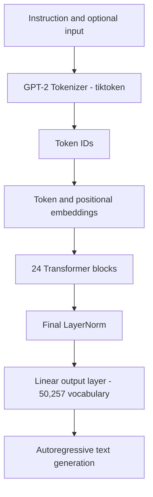

# GPT-2 Medium: Transformer Architecture Built from Scratch with PyTorch | Instruction Fine-Tuning


---

## 📝 Table of Contents
- [📌 About the Project](#-about-the-project)
- [📉 Model Performance](#-model-performance)
- [🧠 Architecture Overview](#-architecture-overview)
- [📚 Dataset](#-dataset)
- [🛠️ Requirements](#-requirements)
- [🚀 How to Use](#-how-to-use)
- [🧪 Sample Inference](#-sample-inference)
- [📁 Generated Outputs](#-generated-outputs)
- [📄 License](#-license)
- [📧 Contact](#-contact)

---

## 📌 About the Project

This project demonstrates how to **implement a GPT-2-style decoder-only Transformer architecture from scratch using PyTorch** and instruction-fine-tune it using pretrained **GPT-2 Medium (355M)** weights.

The Transformer components are implemented manually in the notebook. The model is then initialized with the pretrained GPT-2 Medium checkpoint and fine-tuned on an instruction-response dataset. So, the architecture is built from scratch, but the model is **not trained from random initialization**.

The complete implementation and workflow are provided in a single Jupyter Notebook:

**`GPT2_From_Scratch_Instruction_Fine_Tuning.ipynb`**

### Key Highlights
- Manually implemented Transformer blocks, causal multi-head self-attention, feed-forward layers, and GELU activation.
- Loaded pretrained weights from GPT-2 Medium (355M) into the custom PyTorch implementation.
- Used OpenAI's `tiktoken` GPT-2 tokenizer.
- Prepared instruction-response data with padding, shifted targets, and masking.
- Fine-tuned the model using AdamW and monitored training and validation loss.
- Implemented autoregressive generation with greedy decoding, temperature, and optional top-k sampling.
- Generated responses for the test split and saved them in a structured JSON file.

---

## 📉 Model Performance

The following table shows selected recorded checkpoints from the notebook run. The rows use the last logged checkpoint in each epoch; they are not epoch-averaged metrics.

| Epoch | Step | Train Loss | Validation Loss |
|---:|---:|---:|---:|
| 1 | 115 | 0.508 | 0.663 |
| 2 | 230 | 0.294 | 0.657 |
| 3 | 345 | 0.246 | 0.678 |

Before fine-tuning, the recorded loss over five batches was **3.8259** on the training loader and **3.7619** on the validation loader. During fine-tuning, validation loss reached its lowest recorded value of **0.630 at step 210**, then increased to **0.678** at the final checkpoint.

> 📈 Training loss continued to decrease, while validation loss began increasing after its best recorded point. This is worth monitoring when experimenting with the number of epochs and regularization. These losses are from the notebook's recorded run, not a general benchmark or an accuracy score.

---

## 🧠 Architecture Overview

### 🧱 GPT-2 Medium — Decoder-Only Transformer



### Model Configuration

| Parameter | Value |
|---|---:|
| Model | GPT-2 Medium |
| Parameters | 355M |
| Vocabulary size | 50,257 |
| Context length | 1,024 |
| Embedding dimension | 1,024 |
| Transformer blocks | 24 |
| Attention heads | 16 |
| Dropout | 0.0 |
| QKV bias | Enabled |

---

## 📚 Dataset

The notebook downloads `instruction-data.json` from the [`rasbt/LLMs-from-scratch`](https://github.com/rasbt/LLMs-from-scratch) repository when the file is not already available locally. The dataset contains **1,100 instruction-response examples**.

Each record contains an `instruction`, an optional `input`, and the expected `output`:

```json
{
  "instruction": "Who is the author of 'Pride and Prejudice'?",
  "input": "",
  "output": "Jane Austen."
}
```

The data is split by its original order:

| Split | Records | Portion |
|---|---:|---:|
| Training | 935 | 85% |
| Test | 110 | 10% |
| Validation | 55 | 5% |

---

## 🛠️ Requirements

The notebook uses Python and the following packages:

```bash
pip install torch tiktoken numpy matplotlib tqdm requests
```

The pretrained-weight loading cell imports `download_and_load_gpt2` from **`gpt_download3.py`**. Make sure this helper module is available in the notebook's Python environment or on its Python path before running that cell.

A GPU is recommended for the GPT-2 Medium fine-tuning run. Execution time depends on the available hardware; the recorded run in this notebook took approximately 4.65 minutes.

---

## 🚀 How to Use

### 1. Clone the Repository

```bash
git clone https://github.com/syed-masood-pro/Instruction-Tuned-GPT-style-Transformer-from-Scratch.git
cd Instruction-Tuned-GPT-style-Transformer-from-Scratch
```

### 2. Install the Requirements

```bash
pip install torch tiktoken numpy matplotlib tqdm requests
```

### 3. Open the Notebook

Open **`GPT2_From_Scratch_Instruction_Fine_Tuning.ipynb`** using Jupyter Notebook, JupyterLab, or Google Colab.

### 4. Run the Notebook

Make sure `gpt_download3.py` is available in the Python environment, then run the notebook cells in order. The notebook downloads the instruction dataset and pretrained GPT-2 Medium weights when they are needed.

The notebook contains the data preparation, model implementation, pretrained-weight loading, fine-tuning, evaluation, and inference steps. You do not need separate `train.py` or `inference.py` files to follow this notebook workflow.

---

## 🧪 Sample Inference

The following examples are taken from the notebook's recorded test-set predictions.

```text
Instruction:
Rewrite the sentence using a simile.

Input:
The car is very fast.

✅ Expected Response:
The car is as fast as lightning.

🤖 Model Response:
The car is as fast as a bullet.
```

```text
Instruction:
What type of cloud is typically associated with thunderstorms?

✅ Expected Response:
The type of cloud typically associated with thunderstorms is cumulonimbus.

🤖 Model Response:
The type of cloud typically associated with thunderstorms is a cumulus (thin, water-filled, or gas-filled) cloud.
```

```text
Instruction:
Name the author of 'Pride and Prejudice'.

✅ Expected Response:
Jane Austen.

🤖 Model Response:
The author of 'Pride and Prejudice' is Jane Austen.
```

These are qualitative examples only. They show that the model can produce relevant responses, but they are not enough to establish overall model accuracy. The thunderstorm example also shows that a fluent response can still contain a factual error.

---

## 📁 Generated Outputs

When the corresponding notebook cells are executed, the following files are saved in the working directory:

- `gpt2-medium355M-sft.pth` — fine-tuned model state dictionary.
- `loss-plot.png` — training and validation loss plot.
- `instruction-data-with-response.json` — test examples with generated responses added in the `model_response` field.

The `.pth` file stores the model's state dictionary. Recreate the GPT-2 Medium architecture with the same configuration before loading these weights.

---

## ⚠️ Note

The notebook's dataset download function disables SSL certificate and hostname verification. The recorded pretrained-checkpoint download also produced an unverified HTTPS warning. Restore normal SSL verification before using this download workflow in a production environment.

---

## 📄 License

This project is licensed under the MIT License.

## 📧 Contact

**Syed Masood**

✉️ [syedmasood.pro@gmail.com](mailto:syedmasood.pro@gmail.com)

🔗 [GitHub Profile](https://github.com/syed-masood-pro/)

💼 [LinkedIn](https://www.linkedin.com/in/syed-masood-pro/)
